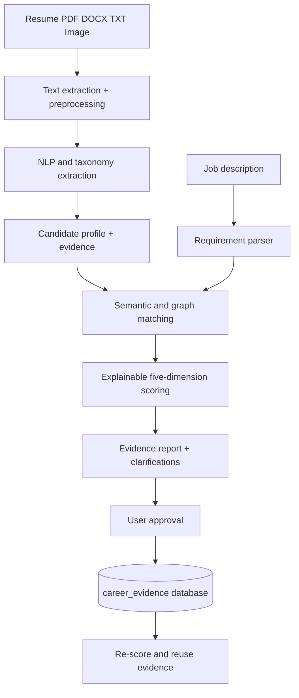

# CareerIntel

CareerIntel is a local-first resume parsing and explainable job-fit assessment app. It extracts verifiable resume evidence, parses job requirements, matches evidence, scores five dimensions, and supports user-approved clarification evidence.

## Quick start

**Python 3.11+ (including 3.13):**

```bash
python -m venv .venv
# Windows: .venv\\Scripts\\activate
# macOS/Linux: source .venv/bin/activate
python -m pip install --upgrade pip
pip install -r requirements.txt
cp .env.example .env  # Windows: copy .env.example .env
uvicorn app.main:app --reload
```

Open http://localhost:8000. API documentation: http://localhost:8000/docs. `run.bat` and `run.sh` automate environment setup and startup. SQLite is created automatically; PostgreSQL is optional using `docker compose up -d postgres` and a `DATABASE_URL` in `.env`.

## Architecture



## Pipeline and scoring

1. Extract text with PyMuPDF, python-docx or plain-text decoding. Image/scanned PDF OCR uses pytesseract when installed and returns a clear message otherwise.
2. Normalize unicode, line breaks, bullets and hyphenation.
3. Extract email, phone, skills, experience ranges, education and quantified achievements using deterministic NLP/regex plus a 280-entry skills taxonomy. Evidence quotes are retained in profile records.
4. Parse job requirements and infer mandatory/preferred status.
5. Match direct evidence, role responsibilities and taxonomy graph paths. Numeric year/degree checks are deterministic.
6. Score five dimensions and show evidence, confidence, strengths, gaps and clarification prompts.
7. Approved user clarifications are persisted and included in subsequent matches for the same resume.

Default weights: skills 0.35, experience 0.25, education 0.10, responsibilities 0.15, achievements 0.15. Weights are normalized to sum to one. `raw = Σ(weight × dimension_score)`. `adjusted = raw × (0.9 + 0.1 × mean_evidence_confidence)`. Classification thresholds: 85 Excellent, 70 Strong, 55 Moderate, 40 Weak, otherwise Poor. Mandatory missing requirements are separately flagged.

The contribution chart uses exact additive Shapley values for this linear weighted score relative to a neutral 50-point baseline: `contribution_i = weight_i × (dimension_i − 50)`. This is the exact Shapley decomposition for an additive model, rather than a KernelExplainer approximation.

## LLM providers

`LLM_PROVIDER=none` is the default and works offline. Provider adapters are included for `anthropic`, `openai` and `ollama`; set the relevant API key/model in `.env`. The current baseline extraction/matching pipeline remains deterministic and local; provider adapters expose `extract_json` for structured extraction extensions. Do not select a cloud provider if your resume must remain local. The UI displays a cloud-provider privacy notice.

## Optional ML acceleration

The core installation intentionally uses plain `uvicorn` rather than `uvicorn[standard]`. The standard extra pulls optional packages such as PyYAML, which may try to compile from source on some Python 3.15 Windows setups; the app does not need those extras to run or use `--reload`. The deterministic baseline works without large model downloads. Optional ML dependencies are isolated in `requirements-ml.txt`; install that file only when your Python release has compatible wheels. `requirements-llm.txt` installs cloud provider SDKs. OCR can be enabled with the Tesseract binary plus `pytesseract` and Pillow. Sentence-transformer embeddings, FAISS retrieval and cross-encoder reranking are not enabled in this baseline build; lexical evidence matching and NetworkX graph inference are used instead. SHAP package is an optional dependency; score contributions are computed exactly for the additive score formula.

For scanned images/PDFs install the Tesseract binary plus `pytesseract` and Pillow. OCR errors are explicit; the app does not silently treat image bytes as text.

## API

- `POST /api/resumes` multipart `file`
- `GET /api/resumes/{id}` and `PUT /api/resumes/{id}`
- `POST /api/jobs` form `text` or `file`
- `POST /api/match` JSON `{ "resume_id": "...", "job_id": "...", "weights": {...} }`
- `GET /api/match/{id}`
- `POST /api/match/{id}/clarifications/{qid}` JSON `{ "answer": "...", "action": "approve|reject|skip" }`
- `POST /api/match/{id}/rescore`
- `GET /api/evidence?resume_id=...`
- `POST /api/demo`
- `GET /api/health`, `GET /api/config`

## Tests

Run `python -m pytest -q` from the project root. The included test suite covers extraction, overlapping date ranges, graph inference, deterministic scoring and API demo flow. Verified in the build environment: **8 passed**. API smoke checks returned HTTP 200 for `/`, `/api/health`, `/api/config`, `/docs`, and `POST /api/demo` (demo score 89.9, Excellent Match).

## Limitations and privacy

This is an engineering baseline, not a hiring decision system. Resume parsing is heuristic and should be reviewed by a human; evidence is shown to support that review. The local `none` provider keeps content on the machine running the server. Cloud providers may receive prompts/document text if wired into extraction. SQLite is the default; uploaded resume text and profiles are stored locally for matching and clarification reuse. Delete `careerintel.db` to remove local demo records. Do not use the app as the sole basis for employment decisions.

## cd "C:\Users\Gigabyte\OneDrive\Desktop\SpaceMarvel\CareerIntel-Complete-Project-Python315-Fix"
## Exection code - ".\run.bat "
